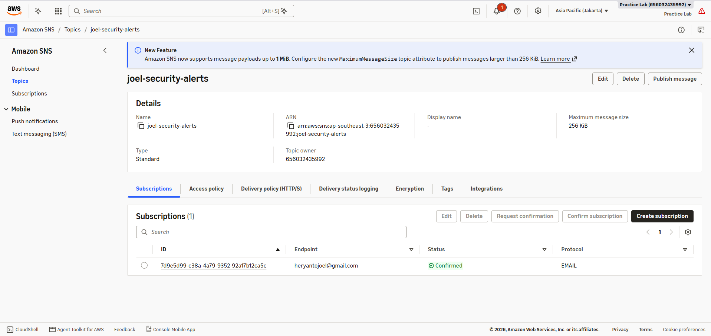
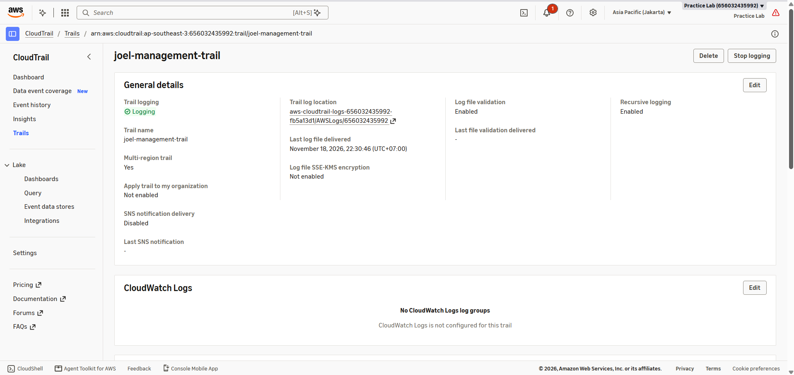
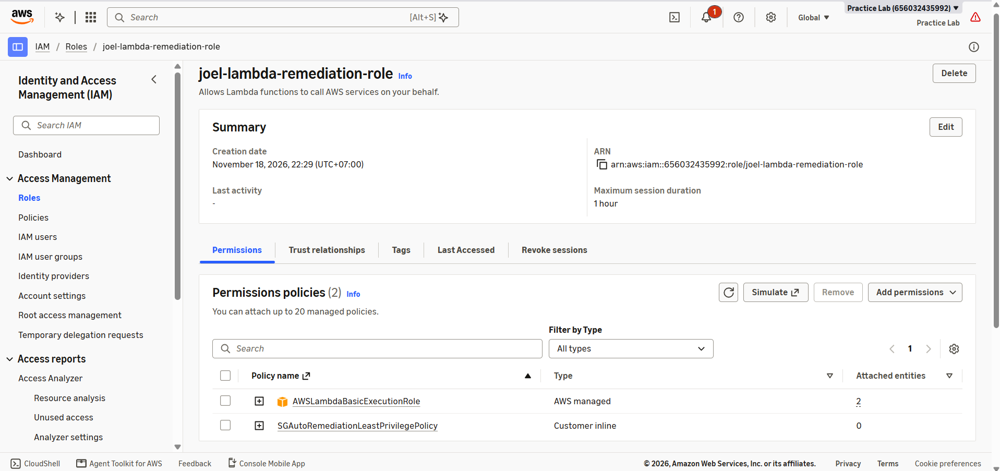
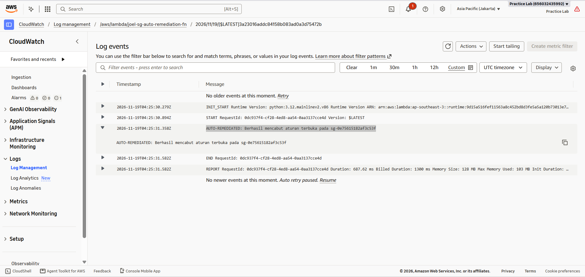
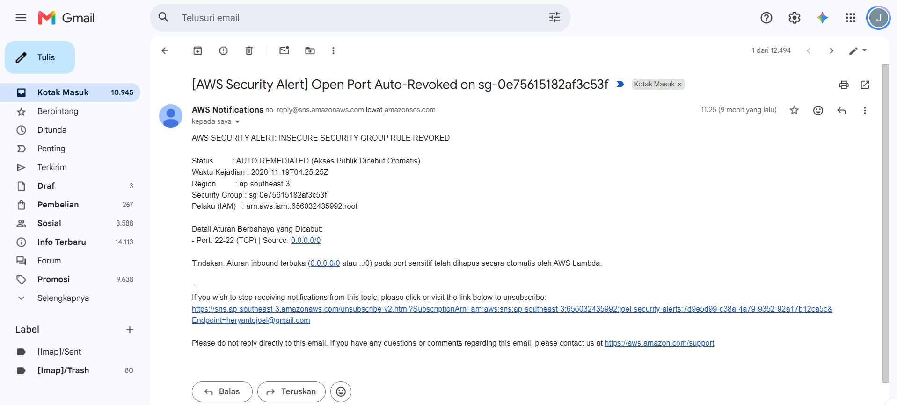

# AWS Automated Security Incident Response & Auto-Remediation

Arsitektur *event-driven DevSecOps* di AWS untuk mendeteksi dan menutup celah keamanan *Security Group* (akses publik 0.0.0.0/0 atau ::/0 pada port sensitif seperti SSH, RDP, database, dan *All Traffic*) secara otomatis dalam hitungan detik.

## Arsitektur Sistem
EC2 Security Group Change -> AWS CloudTrail -> Amazon EventBridge Rule -> AWS Lambda (Python Remediation) -> Amazon SNS (Email Alert)

## Progress Implementasi
- [x] Part 1: Amazon SNS Alert Topic, AWS CloudTrail Management Trail, & IAM Least-Privilege Role
- [x] Part 2: Python Auto-Remediation Lambda, EventBridge Security Pattern, & Live Breach Simulation

## Bukti Implementasi & Pengujian Insiden
### 1. Infrastruktur Keamanan Dasar

### 2. Deteksi EventBridge, Auto-Remediation & Email Alert

